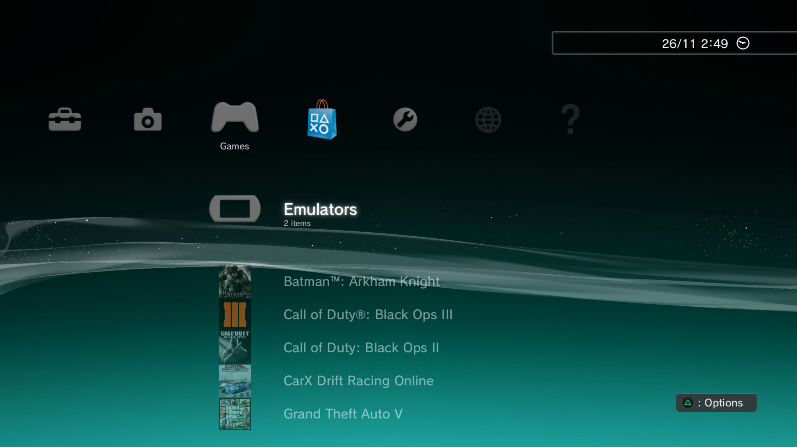
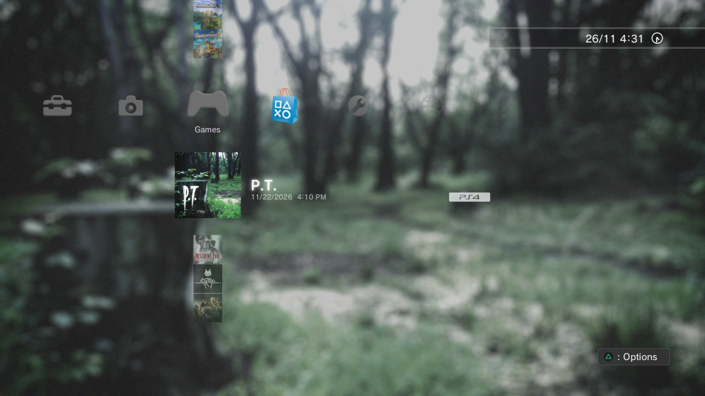
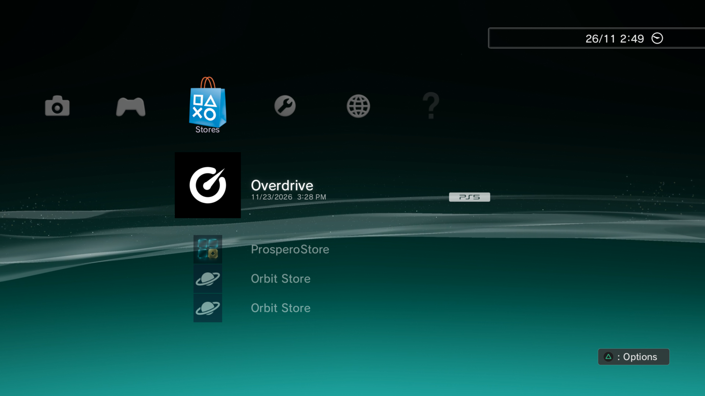
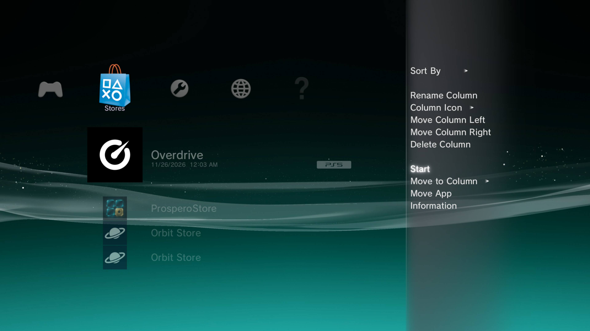

<h1 align="center">XMB5</h1>

  <b>The classic PlayStation 3 experience, reimagined for PlayStation 5.</b>

  
  
  
  

  <a href="https://github.com/mushidani/XMB5/releases">Downloads</a> ·
  <a href="#installation">Installation</a> ·
  <a href="#screenshots">Screenshots</a> ·
  <a href="https://github.com/mushidani/XMB5/issues">Report an Issue</a>

  

## Overview

XMB5 is a native recreation of the PlayStation 3 Cross Media Bar (XMB) for jailbroken PlayStation 5 consoles.

Designed to bring back the identity of the original XMB, XMB5 recreates its iconic layout, atmospheric wave backgrounds, navigation animations, sound effects and familiar visual style while integrating with the PS5's native Home interface.

XMB5 is more than a visual theme. It introduces a completely different way to navigate, organize and personalize your PlayStation 5 experience.

## Features

- Native XMB-style Home interface.
- Classic horizontal and vertical navigation.
- PS3-inspired startup experience.
- Animated wave backgrounds.
- Monthly wave colors with day and night variations.
- Custom categories, folders and icons.
- Custom game and application organization.
- Dynamic game backgrounds and background music.
- Classic navigation sound effects.
- PS3-inspired typography and text glow.
- PS3, PS4 and PS5 platform indicators.
- Photo, music and video browsing.
- Customizable interface and appearance.
- Classic date and animated clock display.
- Return to the original PS5 Home interface.

## Screenshots

<table>
  <tr>
    <td width="50%">
      
      
<b>Dynamic Game Backgrounds</b>

    </td>
    <td width="50%">
      
      
<b>Classic XMB Interface</b>

    </td>
  </tr>
  <tr>
    <td width="50%">
      
      
<b>Folders and Submenus</b>

    </td>
    <td width="50%">
      
      
<b>Custom Categories</b>

    </td>
  </tr>
</table>

## Compatibility

| Firmware | Status |
| :--- | :--- |
| 13.60 | Tested |
| Other firmware versions | Not yet verified |

A compatible jailbreak and ELF payload loader are required.

Compatibility with additional firmware versions will be evaluated through community testing.

## Downloads

Available builds can be found on the [GitHub Releases](https://github.com/mushidani/XMB5/releases) page.

## Installation

1. Activate your PS5 jailbreak.
2. Obtain a compatible `XMB5.elf` build.
3. Load the ELF using your preferred payload loader.
4. Return to the PS5 Home screen.

To restore the original interface, navigate to **PS5 XMB Controls → Return to PS5 Home**.

## Development Status

XMB5 is currently in public beta.

Some features, animations and firmware-specific behavior may require further refinement. Community feedback and testing are appreciated.

If you encounter an issue, please include your firmware version, jailbreak environment, XMB5 version and relevant logs. Remove any personal information from logs before sharing them.

[Report a bug or request a feature](https://github.com/mushidani/XMB5/issues)

## Credits

**XMB5** is developed by [mushidani](https://github.com/mushidani).

Special thanks to:

| Project | Contribution |
| :--- | :--- |
| [ZhiThemes by Zhi](https://github.com/itsRealZhi/ZhiThemes) | Native PS5 theme engine |
| [xmb-web by TheGammaSqueeze](https://github.com/TheGammaSqueeze/xmb-web) | XMB rendering and visual reference |

XMB5 is a modified project based on ZhiThemes.

See [CREDITS.md](CREDITS.md) and [NOTICE](NOTICE) for full upstream and third-party attribution.

## License

XMB5 is licensed under the GNU General Public License version 3 or later, subject to the additional attribution requirements specified in NOTICE.

Third-party assets retain their respective licenses.

See [LICENSE](LICENSE) for more information.

## Disclaimer

XMB5 is an independent, unofficial homebrew project. It is not affiliated with, endorsed by or sponsored by Sony Interactive Entertainment.

Use at your own discretion.

---

  If you enjoy XMB5, consider giving the repository a star.

  <b>Developed by <a href="https://github.com/mushidani">mushidani</a></b>

